# Лабораторная работа: безопасность системы и файловые системы

**Стенд:** виртуальная машина VirtualBox `laba1`, Debian 13 (trixie), пользователь `vboxuser`.

## Содержание
1. [Настройка файрвола](#1-настройка-файрвола)
2. [Обеспечение безопасности системы](#2-обеспечение-безопасности-системы)
3. [Управление файловыми системами](#3-управление-файловыми-системами)
4. [Мониторинг дискового пространства](#4-мониторинг-дискового-пространства)

---

## 1. Настройка файрвола

### 1.1. Установите и настройте UFW (Uncomplicated Firewall)

```bash
sudo apt update
sudo apt install ufw -y
```

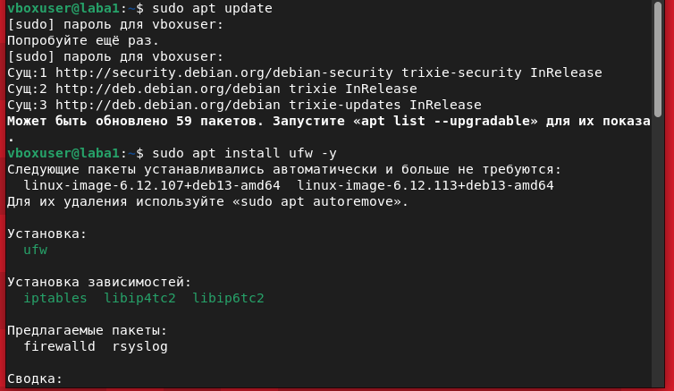

### 1.2. Разрешите только SSH и HTTP/HTTPS

```bash
sudo ufw allow ssh     # 22/tcp
sudo ufw allow https   # 443
sudo ufw allow http    # 80/tcp
sudo ufw enable
```

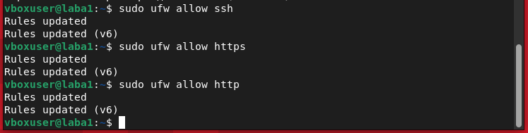

### 1.3. Проверьте настройки с помощью `ufw status` и `iptables`

```bash
sudo ufw status verbose
```

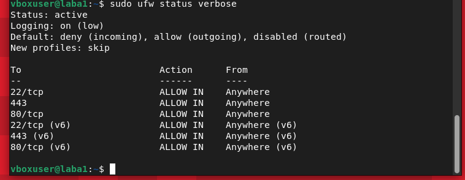

Файрвол активен. Входящие соединения по умолчанию запрещены, исходящие разрешены. Открыты только порты 22, 80 и 443 (IPv4 и IPv6).

```bash
sudo iptables -L
```

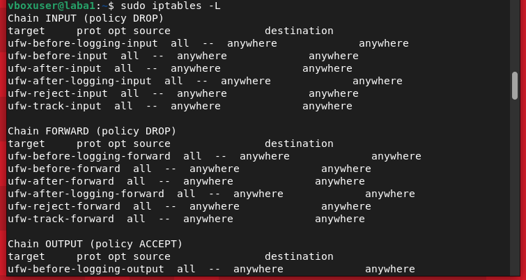

Политика цепочек INPUT и FORWARD — DROP, OUTPUT — ACCEPT. Правила UFW подключены через цепочки `ufw-*`.

## 2. Обеспечение безопасности системы

### 2.1. Настройте автоматические обновления безопасности

Автоматические обновления настраиваются пакетом `unattended-upgrades`:

```bash
sudo apt install unattended-upgrades -y
sudo dpkg-reconfigure --priority=low unattended-upgrades
```

В диалоге на вопрос о автоматической установке обновлений нужно выбрать **«Да»**.

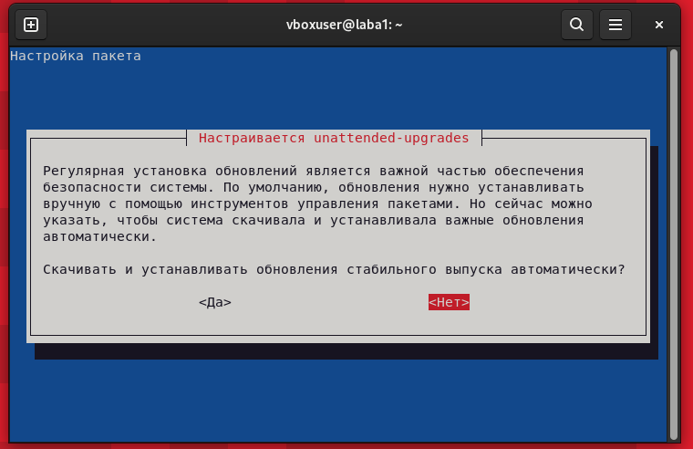

В результате создаётся файл `/etc/apt/apt.conf.d/20auto-upgrades`.

### 2.2. Установите и настройте fail2ban для защиты от брутфорс-атак

```bash
sudo apt install fail2ban -y
```

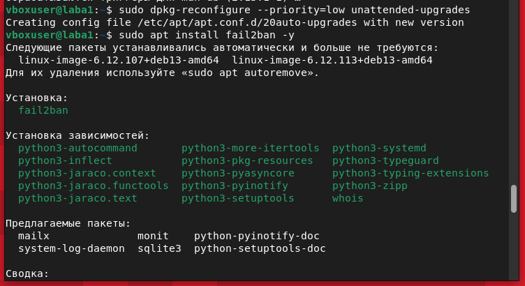

Конфигурация защиты SSH (`/etc/fail2ban/jail.local`):

```ini
[sshd]
enabled = true
port = ssh
filter = sshd
logpath = /var/log/auth.log
maxretry = 3
bantime = 600
```

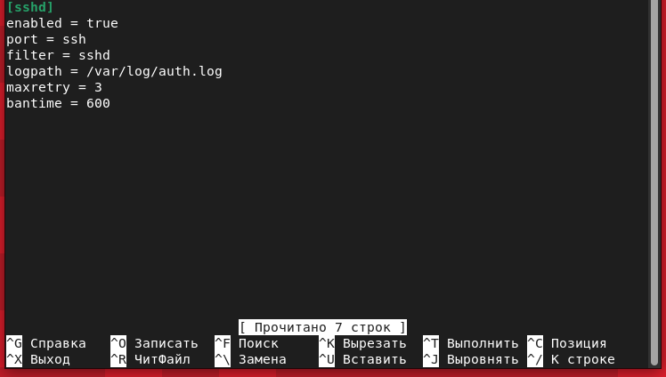

После 3 неудачных попыток входа IP-адрес блокируется на 600 секунд (10 минут).

```bash
sudo systemctl restart fail2ban
sudo systemctl status fail2ban
```

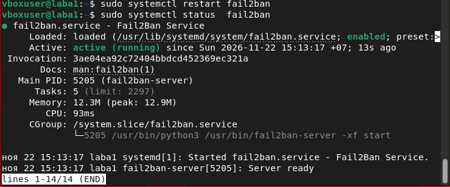

Служба запущена (`active (running)`) и включена в автозагрузку.

## 3. Управление файловыми системами

### 3.1. Создайте новый виртуальный диск и подключите его к системе

В настройках ВМ в разделе «Носители» создан диск `laba1_1.vdi` формата VDI размером 20 ГБ и подключён к машине.

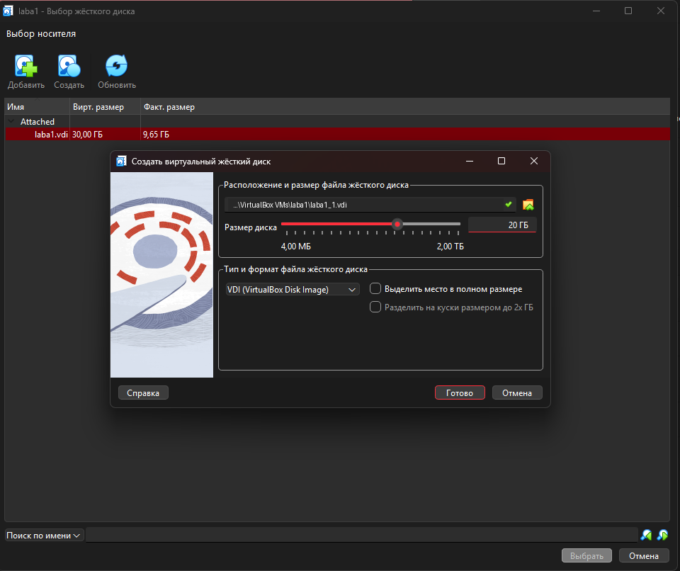

```bash
lsblk
```

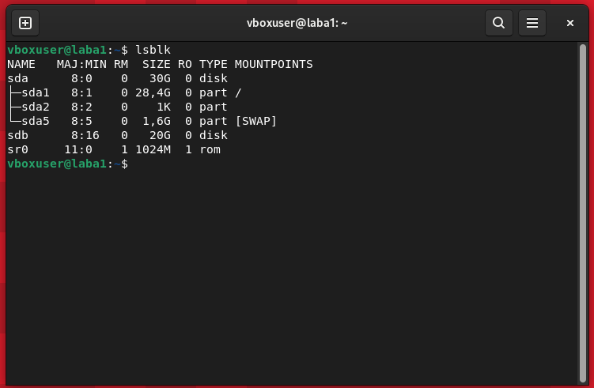

Новый диск виден как `/dev/sdb` (20 ГБ).

### 3.2. Отформатируйте диск в ext4 и смонтируйте в `/mnt/storage`

```bash
sudo mkfs.ext4 /dev/sdb
```

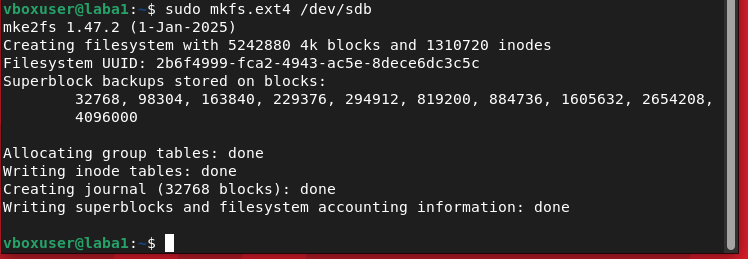

```bash
sudo mkdir -p /mnt/storage
sudo mount /dev/sdb /mnt/storage
```

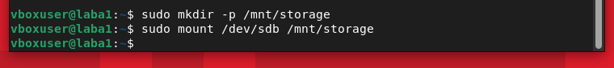

### 3.3. Настройте автоматическое монтирование при запуске системы

Узнаём UUID диска, добавляем запись в `/etc/fstab` и проверяем её:

```bash
sudo blkid /dev/sdb
sudo nano /etc/fstab
sudo mount -a
```

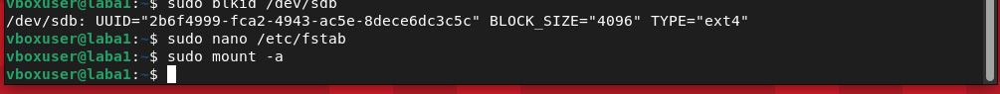

Добавленная строка:

```
UUID=2b6f4999-fca2-4943-ac5e-8dece6dc3c5c /mnt/storage ext4 defaults 0 2
```

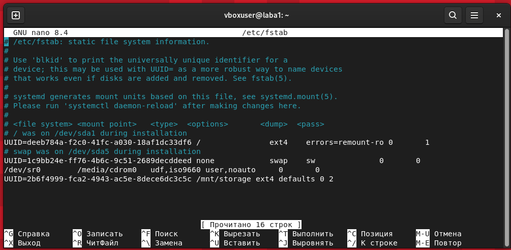

Команда `mount -a` выполнилась без ошибок.

## 4. Мониторинг дискового пространства

### 4.1. Анализ с помощью `du`, `df`, `lsblk`, `fdisk`

**`df -h`** показывает занятое и свободное место на файловых системах:

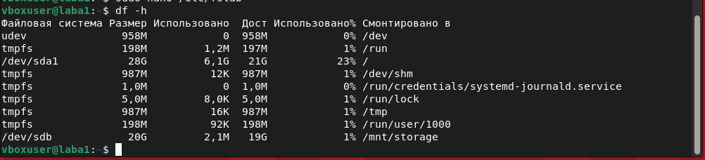

Корневой раздел занят на 23%, диск `/dev/sdb` смонтирован в `/mnt/storage`.

**`du`** показывает размер каталога:

```bash
sudo du -sh /var/log
```

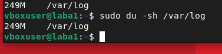

Каталог `/var/log` занимает 249 МБ.

**`lsblk`** показывает диски и разделы (вывод приведён в пункте 3.1).

**`fdisk`** показывает таблицы разделов:

```bash
sudo fdisk -l
```

<!-- Сделайте скриншот, сохраните как 19-fdisk.png и уберите эти строки комментария

-->

### 4.2. Оповещение при 80% заполнения (скрипт + cron)

Скрипт [`check_disk.sh`](check_disk.sh) проверяет заполнение корневого раздела и, если оно больше 80%, отправляет письмо пользователю `root`:

```bash
#!/bin/bash
THRESHOLD=80
CURRENT=$(df / | grep / | awk '{ print $5}' | sed 's/%//g')
if [ "$CURRENT" -gt "$THRESHOLD" ]; then
	echo "Vnimanie : Disk zapolnen na $CURRENT%" | mail -s "Disk Alert" root
fi
```

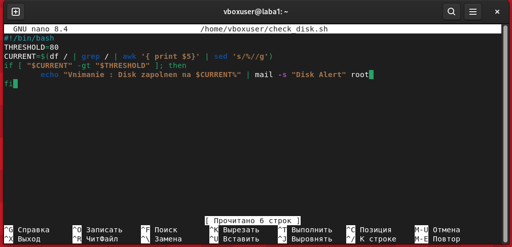

Для команды `mail` нужен почтовый пакет:

```bash
sudo apt install mailutils -y
```

Делаем скрипт исполняемым и открываем планировщик:

```bash
chmod +x ~/check_disk.sh
crontab -e
```

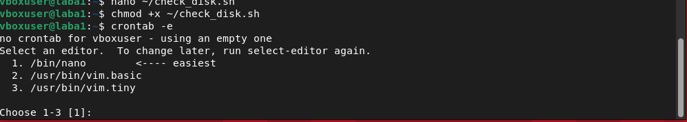

Строка для запуска каждый час:

```
0 * * * * /home/vboxuser/check_disk.sh
```

<!-- Сделайте скриншот вывода crontab -l, сохраните как 20-cron-list.png и уберите комментарий

-->

## Вывод

Настроен файрвол UFW с доступом только по SSH и HTTP/HTTPS, настраивались автоматические обновления и защита fail2ban. Подключён, отформатирован и добавлен в автозагрузку новый диск. Изучены средства анализа дискового пространства и подготовлен скрипт оповещения для запуска через cron.
